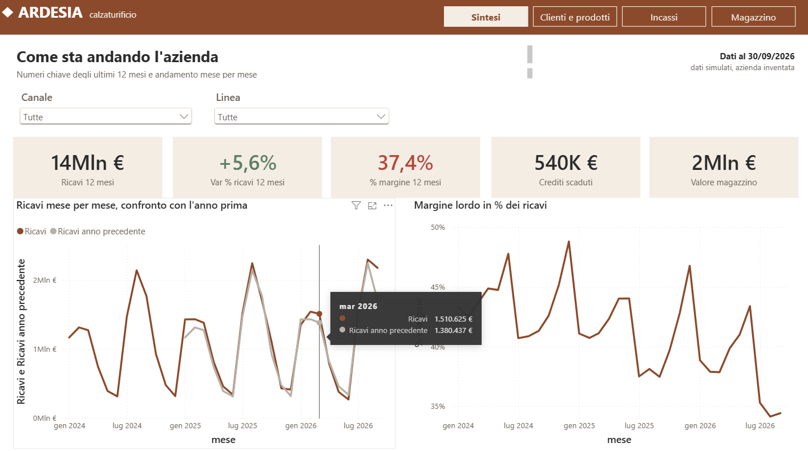

# Dashboard dimostrativa per PMI - Power BI

Cruscotto di controllo di gestione per **Calzaturificio Ardesia**, azienda inventata del distretto calzaturiero marchigiano: vendite, margini,
incassi e magazzino da gennaio 2024 a settembre 2026. **Tutti i dati sono simulati**:
servono a mostrare cosa può vedere un'azienda quando i dati del gestionale e dei file Excel
vengono messi in ordine e aggiornati in automatico.

Altre pagine: [clienti e prodotti](immagini/pbi-clienti.png), [incassi](immagini/pbi-incassi.png),
[magazzino](immagini/pbi-magazzino.png), [modello dati](immagini/pbi-modello.png).

`genera_dati.py` crea i CSV in `dati/` (seme fisso, risultati sempre uguali).

## Aprire il progetto

Doppio clic su `DemoPMI.pbip` (Power BI Desktop), poi **Aggiorna**. Se la cartella viene
spostata, cambiare il parametro `CartellaDati` (Trasforma dati > Gestisci parametri),
che deve finire con `\`.

## Pagine

1. **Sintesi**: ricavi, crescita e margine degli ultimi 12 mesi, crediti scaduti, valore del magazzino
2. **Clienti e prodotti**: margine e sconto per canale, margine per categoria e linea, classifica clienti
3. **Incassi**: crediti aperti per fascia di scadenza, clienti con più scaduto e ritardo medio
4. **Magazzino**: valore per stagione di collezione, articoli fermi da più tempo, rotazione

## Cosa raccontano i dati

- I ricavi crescono (+4% nei primi nove mesi del 2026), ma il margine lordo scende dal 42,6% del
  2024 al 36,6%: gli sconti all'ingrosso aumentano e il costo della pelle sale.
- Un solo grossista pesa per oltre un terzo dei crediti scaduti.
- Circa un quarto del valore del magazzino è merce delle stagioni passate, ferma da oltre sei mesi.

## Aspetto

Tema con i colori di un ipotetico marchio (cuoio `#8B4A2B`, crema `#F3EDE4`, antracite `#2B2B2B`), fascia con
logotipo e pulsanti di navigazione tra le pagine. Verde salvia e rosso mattone solo per gli scostamenti:
variazione dei ricavi, margine rispetto alla media e rispetto all'anno prima, ritardo nei pagamenti.

## Modello

Schema a stella: tre tabelle dei fatti (`fatti_vendite`, righe di vendita; `fatti_scadenze`,
fatture con scadenza e incasso; `fatti_magazzino`, giacenze di fine mese al costo) e tre
dimensioni (`dim_data`, calendario giornaliero segnato come tabella date; `dim_cliente`;
`dim_prodotto`).

Scelte da notare:
- le misure "12 mesi" usano `DATESINPERIOD` a partire dall'ultima data nel contesto, quindi
  funzionano anche filtrando un anno;
- il magazzino è una fotografia di fine mese: `Valore magazzino` prende l'ultima rilevazione
  disponibile invece di sommare nel tempo;
- lo scadenzario è calcolato alla data di aggiornamento (30/09/2026) e non è collegato al
  calendario, perché l'anzianità dei crediti si legge sempre a oggi.
